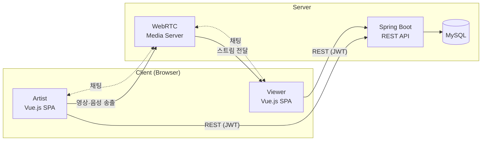

# 🎤 버스킹 어게인 (Busking Again)

**WebRTC 기반 비대면 버스킹 플랫폼**

거리에 설 수 없게 된 아티스트와 관객을, 온라인 버스킹 무대로 다시 연결합니다.

`SSAFY 5기 2학기 공통 프로젝트` · `2021.07 ~ 2021.08 (6주)` · `5인 팀 (FE 2 · BE 3)`

---

## 📌 목차

- [프로젝트 소개](#-프로젝트-소개)
- [핵심 기능](#-핵심-기능)
- [기존 서비스와의 차별점](#-기존-서비스와의-차별점)
- [시스템 아키텍처](#-시스템-아키텍처)
- [기술 스택](#-기술-스택)
- [팀 구성과 담당 역할](#-팀-구성과-담당-역할)
- [협업 방식](#-협업-방식)
- [2026 재구현 코드](#-2026-재구현-코드)
- [회고](#-회고)

---

## 💡 프로젝트 소개

코로나19로 거리 공연이 어려워지면서 버스커들은 무대를, 관객은 우연히 마주치는 공연의 즐거움을 잃었습니다.
**버스킹 어게인**은 장비나 공간 없이 브라우저만으로 버스킹을 열고, 관객이 실시간으로 반응하며 함께하는 **양방향 온라인 버스킹 플랫폼**입니다.

- 와이어프레임: [Figma](https://www.figma.com/file/95aVyXNvebpb04nO8lXGSb/Project-1?node-id=0%3A1)

---

## ✨ 핵심 기능

| 기능 | 설명 |
|---|---|
| **회원 관리** | 회원가입, 로그인/로그아웃(토큰 기반 인증), 회원 정보 수정 |
| **버스킹 생성** | 아티스트가 제목·장르·소개를 입력해 공연방을 열고 WebRTC로 실시간 방송 시작 |
| **버스킹 시청** | 관객이 공연방에 입장해 실시간 영상·음성 시청 |
| **실시간 채팅** | 공연 중 아티스트와 관객이 채팅으로 소통 |
| **버스킹 목록** | 전체 목록, **랜덤** 목록, **선호 장르** 목록 3가지 방식으로 탐색 |
| **장르 팔로우** | 특정 가수가 아닌 장르를 팔로우해 취향에 맞는 공연을 추천받음 |

---

## 🎯 기존 서비스와의 차별점

- **낮은 진입장벽** — 별도 장비·송출 프로그램 없이 웹 브라우저만으로 공연 시작
- **양방향 소통** — 단방향 스트리밍과 달리 관객 반응을 공연자가 실시간으로 확인
- **장르 팔로우** — 이미 아는 가수가 아니라 좋아하는 장르의 새로운 버스커를 발견
- **랜덤 목록** — 길을 걷다 우연히 공연을 만나는 버스킹 특유의 경험을 재현

---

## 🏗 시스템 아키텍처

---

## 🛠 기술 스택

| 구분 | 기술 |
|---|---|
| **Frontend** | Vue.js, Vuex, Vue Router, Axios |
| **Realtime** | WebRTC |
| **Backend** | Spring Boot, Spring Data JPA |
| **Database** | MySQL |
| **UI** | Vue Argon Design System, Element Plus |
| **Collaboration** | Git, Jira, Figma, Google Sheets(API 명세) |

---

## 👥 팀 구성과 담당 역할

| 이름 | 역할 |
|---|---|
| **장용원** | **Frontend** |
| 변우석 | Frontend |
| 권현지 | Backend |
| 김은비 | Backend |
| 정태현 | Backend |

### 내가 담당한 부분 (Frontend · 장용원)

- Vue.js 기반 SPA 화면 구현 및 Vue Router 라우팅 구성
- Vuex로 로그인 토큰·사용자 정보·공연방 상태 관리
- Axios 공통 인스턴스로 REST API 연동, 로그인 이후 요청 헤더에 토큰 자동 첨부
- WebRTC 공연방 화면(방송 시작·시청)과 실시간 채팅 UI 구현
- 버스킹 목록(전체·랜덤·선호 장르) 화면과 장르 팔로우 UI 구현

---

## 🤝 협업 방식

**Git 컨벤션**
- 커밋 메시지: `이름 + 날짜 + 수정 내용` (예: `장용원 210719 버스킹 목록 화면 추가`)
- 1인 1일 1커밋 이상, 매일 아침 FE·BE 브랜치 merge
- 공통 영역 수정 시 커밋 전 팀원과 사전 협의

**Jira**
- 이슈 제목: `[FE]` / `[BE]` + 제목, 레이블로 파트 구분
- 개인이 담당 이슈의 Story Point·하위 태스크를 직접 관리

**REST API 규칙**

| 동작 | Method | URI |
|---|---|---|
| 생성 | `POST` | `/{카테고리}/create` |
| 조회 | `GET` | `/{카테고리}/{id}` |
| 수정 | `PATCH` | `/{카테고리}/{id}` |
| 삭제 | `DELETE` | `/{카테고리}/{id}` |

- 로그인 이후 모든 요청은 Request Header에 토큰 필수
- API 명세는 FE·BE 협의 후 공유 문서에 기록

---

## 🔁 2026 재구현 코드

원본 코드는 SSAFY GitLab에 있어 이 저장소에는 포함되어 있지 않습니다.
핵심 기능(회원·장르 팔로우·버스킹 목록·WebRTC 공연방·실시간 채팅)을 **Vue 3 + Node.js로 다시 구현한 코드**를 [`rebuild/`](rebuild/) 폴더에 정리했습니다.

---

## 📝 회고

- **실시간 서비스의 상태 관리** — 공연방 입장·퇴장, 방송 시작·종료처럼 서버와 클라이언트 상태가 계속 바뀌는 화면을 다루며, 상태를 한곳(Vuex)에 모으고 화면은 그 상태를 그리기만 하도록 나누는 것이 중요하다는 것을 배웠습니다.
- **FE·BE 협업** — API 규칙과 명세 문서를 먼저 합의하고 개발을 시작한 덕분에, 6주라는 짧은 기간에도 연동 과정의 혼선을 줄일 수 있었습니다.
- **이후의 경험으로 이어진 점** — 이 프로젝트에서 처음 경험한 "실시간·비동기 상태를 어떻게 신뢰할 수 있게 보여줄 것인가"라는 고민은, 이후 재해복구(DR) 복제 오케스트레이션 서비스를 개발하며 상태 조회 정합성을 다루는 일로 이어졌습니다.
