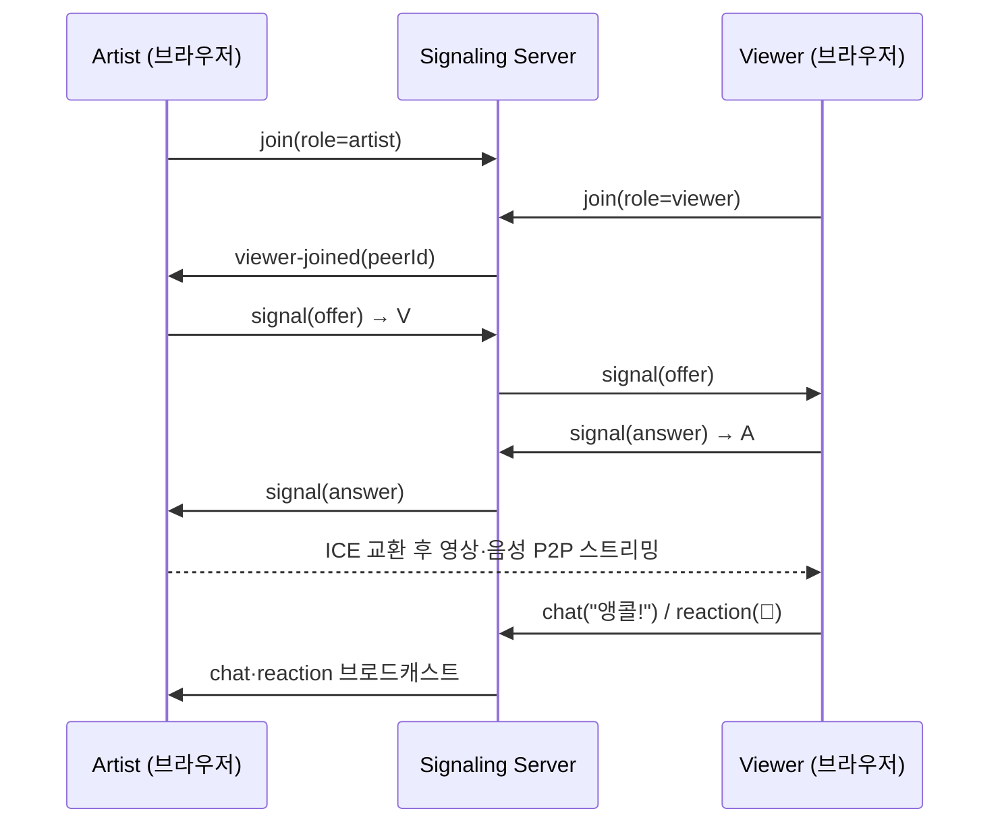

# 🔁 BuskingAgain — 2026 재구현 (Rebuild)

> 이 폴더는 2021년 SSAFY 공통 프로젝트 **버스킹 어게인**을 **2026년에 다시 구현한 코드**입니다.
> 원본 코드는 SSAFY GitLab에 있어 이 저장소에 포함되어 있지 않으며, 핵심 기능과 구조를 기억과 기획 문서를 바탕으로 새로 작성했습니다.

> 📖 파일별 설명·핵심 흐름·예상 면접 질문은 **[docs/CODE_GUIDE.md](docs/CODE_GUIDE.md)** 에 정리했습니다.

## 원본과 달라진 점

| 구분 | 원본 (2021) | 재구현 (2026) |
|---|---|---|
| Frontend | Vue 2 · Vuex | **Vue 3 (Composition API)** · Vuex 4 · Vue Router 4 · Vite |
| Backend | Spring Boot · MySQL | **Node.js (Express)** + 인메모리 저장소 — 프론트 시연용 경량 서버 |
| 실시간 | WebRTC | WebRTC (1:N mesh) + **WebSocket 시그널링 서버 직접 구현** |

## 구조

```
rebuild/
├── server/                 # REST API + WebRTC 시그널링 + 채팅
│   ├── index.js            # Express 라우팅 (원본 팀의 REST 규칙: /create, /{id})
│   ├── store.js            # 회원·장르 팔로우·버스킹 도메인 로직
│   ├── signaling.js        # offer / answer / ICE 중계, 채팅, 리액션, 시청자 수, 도배 방지
│   ├── store.test.js       # 도메인 규칙 단위 테스트
│   └── api.test.js         # 실제 서버 + WebSocket 통합 테스트
├── e2e/webrtc.e2e.mjs      # 두 브라우저로 실제 영상 연결을 확인하는 E2E 테스트 (Playwright)
├── docs/                   # 코드 가이드, 스크린샷
└── frontend/
    └── src/
        ├── api/http.js         # axios 공통 인스턴스 (토큰 자동 첨부, 에러 메시지 통일)
        ├── store/index.js      # Vuex: 로그인 토큰·사용자·팔로우 장르
        ├── lib/buskingRoom.js  # WebRTC 연결 + 채팅 클라이언트
        ├── router.js           # 로그인 필요 페이지 가드
        └── views/              # 목록(전체·랜덤·선호 장르) / 공연방 / 공연 생성 / 로그인 / 회원가입 / 마이페이지
```

## 동작 흐름



## 실행 방법

```bash
# 1) 서버 (http://localhost:8080)
cd server && npm install && npm start

# 2) 프론트엔드 (http://localhost:5173)
cd frontend && npm install && npm run dev
```

1. 브라우저 두 개(또는 일반 창 + 시크릿 창)에서 각각 회원가입합니다.
2. 한쪽에서 **버스킹 시작** → 카메라·마이크 허용
3. 다른 쪽에서 목록의 공연을 눌러 입장하면 영상이 연결되고 채팅을 주고받을 수 있습니다.

```bash
# 서버 단위 + 통합 테스트 (12개)
cd server && npm test

# E2E: 서버·프론트를 띄운 상태에서 실행
cd e2e && npm install && npm test
```
