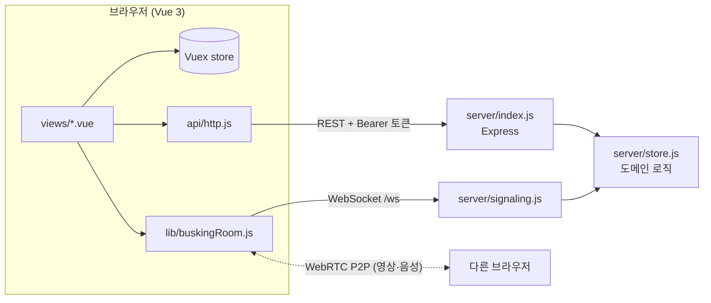
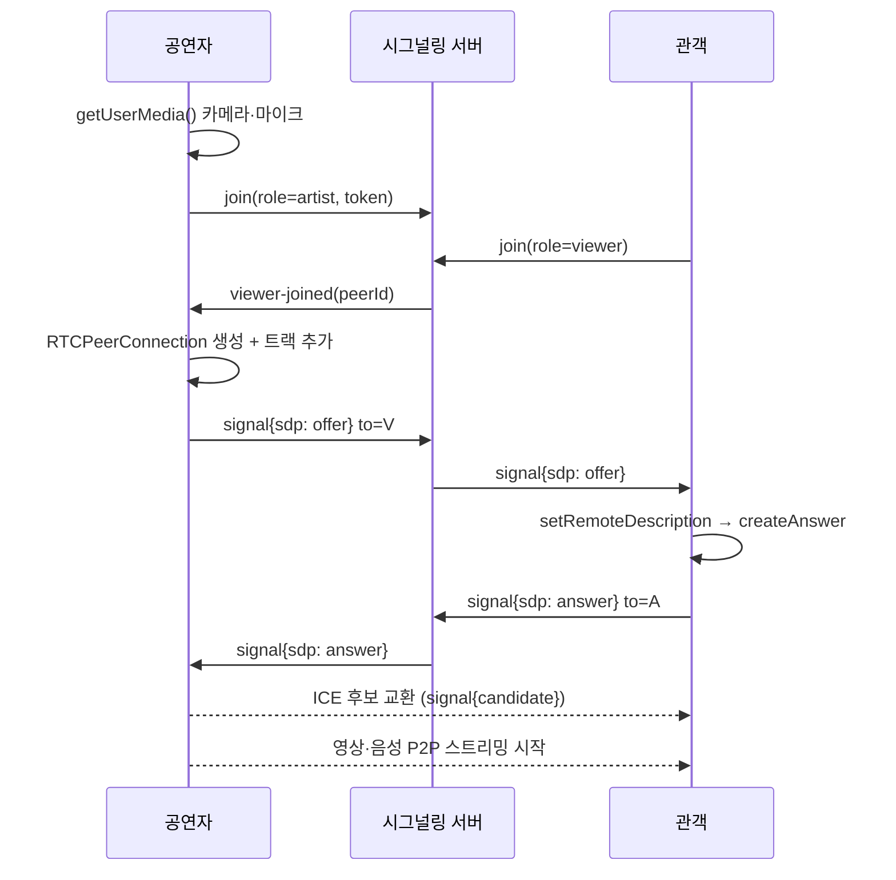

# 📖 BuskingAgain 재구현 — 코드 가이드

이 문서는 `rebuild/` 코드를 처음 보는 사람(그리고 면접 준비를 하는 나)을 위해
**어디서부터 읽으면 되는지, 각 파일이 무슨 일을 하는지, 핵심 흐름이 어떻게 동작하는지**를 정리한 문서입니다.

> **E2E 실행 결과** (`e2e/webrtc.e2e.mjs`, 크롬 두 개로 실제 WebRTC 연결)
>
> ```
> viewer video: [640,480,["audio","video"]]   ← 관객 화면에 공연자 영상·음성 트랙이 실제로 재생됨
> artist got chat                              ← 관객 채팅이 공연자에게 도착
> artist saw reaction                          ← 👏 리액션이 공연자 화면에 표시
> viewer count on artist: artist · 👀 1명 시청 중
> viewer saw ended                             ← 공연 종료가 관객에게 전달
> ```

---

## 1. 전체 구조



- **REST**: 회원, 장르 팔로우, 버스킹 생성·조회·종료처럼 "저장되는 데이터"
- **WebSocket**: WebRTC 연결 정보 교환(시그널링), 채팅, 리액션, 시청자 수처럼 "실시간 이벤트"
- **WebRTC**: 실제 영상·음성은 서버를 거치지 않고 브라우저끼리 직접 전달

## 2. 읽는 순서 추천

1. `server/store.js` — 서비스 규칙이 전부 여기 있습니다. 가장 먼저 읽으면 나머지가 쉽게 읽힙니다.
2. `server/index.js` — URL과 store 함수의 연결, 토큰 인증 미들웨어
3. `server/signaling.js` — 방(room) 관리와 메시지 중계
4. `frontend/src/lib/buskingRoom.js` — 브라우저 쪽 WebRTC 로직
5. `frontend/src/views/BuskingRoomView.vue` — 위 클래스를 화면에 붙이는 방법

## 3. 파일별 설명

### server

| 파일 | 역할 | 핵심 포인트 |
|---|---|---|
| `store.js` | 회원·세션·버스킹 인메모리 저장소 | 비밀번호는 SHA-256 해시로 저장, 토큰은 랜덤 24바이트. 공연자 1명당 동시에 1개 공연만 가능. `listBuskings`의 `mode`로 전체·랜덤(Fisher–Yates 셔플 후 6개)·선호 장르 분기 |
| `index.js` | Express 라우팅 | `auth` 미들웨어가 `Authorization: Bearer` 토큰으로 사용자를 찾아 `req.user`에 넣음. 에러는 `httpError(status, message)`로 던지고 마지막 미들웨어 한 곳에서 응답 |
| `signaling.js` | WebRTC 시그널링 + 채팅 + 리액션 | 방마다 공연자 1명 + 관객 Map. 공연자만 `artist` 역할로 입장 가능(토큰 검증). 채팅은 로그인 사용자만, 채팅·리액션 모두 사용자당 1초 5회로 제한 |
| `store.test.js` | 도메인 규칙 단위 테스트 | 중복 가입, 잘못된 비밀번호, 1인 1공연, 장르 필터, 종료 권한 |
| `api.test.js` | 실제 서버를 띄운 통합 테스트 | 랜덤 포트로 서버를 띄우고 HTTP + WebSocket으로 offer/answer 중계, 채팅 권한, 도배 제한, 공연 종료 알림까지 검증 |

### frontend

| 파일 | 역할 |
|---|---|
| `api/http.js` | axios 공통 인스턴스. 요청마다 토큰을 자동으로 붙이고, 서버 에러 메시지를 `Error.message`로 통일 |
| `store/index.js` | Vuex. 토큰과 사용자 정보를 `localStorage`와 동기화해 새로고침해도 로그인 유지 |
| `router.js` | `meta.auth` 페이지는 로그인 안 했으면 `/login?redirect=...`로 보냈다가 로그인 후 원래 페이지로 복귀 |
| `lib/buskingRoom.js` | WebRTC + WebSocket 클라이언트 클래스. 화면(Vue)과 분리해 두어 다른 화면에서도 재사용 가능 |
| `views/BuskingListView.vue` | 전체 / 랜덤 / 선호 장르 탭 |
| `views/BuskingRoomView.vue` | 영상, 채팅, 리액션, 시청자 수, 공연 종료 |
| `views/CreateBuskingView.vue` | 공연 생성 후 바로 공연방으로 이동 |
| `views/MyPageView.vue` | 닉네임 변경, 장르 팔로우 토글 |

## 4. 핵심 흐름

### 4-1. 공연자와 관객이 연결되는 과정 (WebRTC 시그널링)



- 서버는 SDP·ICE 내용을 해석하지 않고 `to`에 적힌 상대에게 **그대로 전달만** 합니다.
- 관객이 공연자보다 먼저 들어오면, 공연자가 입장하는 순간 대기 중인 관객 모두에게 offer를 보냅니다.

### 4-2. 공연 종료
- 공연자가 "공연 종료" → REST `DELETE /buskings/:id` → WebSocket 종료
- 서버는 공연자 소켓이 닫히면 방의 모든 관객에게 `ended`를 보내고, 관객 화면은 "공연이 끝났어요"로 바뀝니다.

### 4-3. 채팅·리액션 보호
- 비로그인 관객은 영상은 볼 수 있지만 채팅은 서버에서 거절됩니다. 화면에서 막는 것과 별개로 **서버에서도 검증**합니다.
- `allow(peer)`: 최근 1초 동안 보낸 이벤트 시각을 기록해 5개를 넘으면 버립니다(슬라이딩 윈도우).

## 5. 테스트

```bash
cd server && npm test          # 단위 + 통합 테스트 12개
# 서버와 프론트를 띄운 상태에서
cd e2e && npm install && npm test   # 두 브라우저로 실제 WebRTC 연결 확인
```

| 종류 | 무엇을 확인하나 |
|---|---|
| 단위 (`store.test.js`) | 서비스 규칙 |
| 통합 (`api.test.js`) | REST + WebSocket 시그널링이 실제 서버에서 동작하는지 |
| E2E (`e2e/webrtc.e2e.mjs`) | 가짜 카메라로 방송 → 관객 화면에 영상 프레임이 실제로 재생되는지, 채팅·리액션·종료 |

## 6. 한계와 다음 단계

| 현재 | 개선 방향 |
|---|---|
| 1:N **mesh** — 공연자가 관객 수만큼 연결을 직접 유지 | 관객이 많아지면 업로드 대역폭이 부족 → **SFU**(mediasoup, LiveKit, OpenVidu 등)로 서버가 한 번 받아 여러 명에게 분배 |
| STUN만 사용 | 방화벽·대칭 NAT 환경을 위해 **TURN 서버** 추가 |
| 인메모리 저장소 | 서버 재시작 시 데이터 유실 → DB(MySQL) + 세션 저장소(Redis) |
| 토큰 만료 없음 | JWT + 만료·재발급(refresh token) |
| 단일 서버 | 여러 서버로 늘릴 때 방 정보를 Redis Pub/Sub 등으로 공유 |

## 7. 예상 면접 질문

**Q. WebRTC인데 왜 서버가 필요한가요?**
영상은 P2P로 가지만, 서로의 주소와 코덱 정보(SDP)·연결 후보(ICE)를 처음에 교환할 통로가 필요합니다. 그 역할이 시그널링 서버이고, 이 프로젝트에서는 WebSocket으로 직접 구현했습니다.

**Q. mesh 구조의 한계는?**
공연자 1명이 관객 N명에게 각각 영상을 올려야 해서, 관객이 늘수록 공연자의 업로드 대역폭과 CPU가 선형으로 늘어납니다. 실서비스 규모라면 SFU로 바꿔 공연자는 서버에 한 번만 올리게 해야 합니다.

**Q. STUN과 TURN의 차이는?**
STUN은 내 공인 IP·포트를 알아내 P2P 연결을 시도하게 돕고, TURN은 P2P가 막힌 환경에서 영상을 대신 중계합니다. TURN은 트래픽이 서버를 지나므로 비용이 큽니다.

**Q. 채팅 도배는 어떻게 막았나요?**
소켓(사용자)마다 최근 1초간 보낸 메시지 시각을 기록하고 5개를 넘으면 버리는 슬라이딩 윈도우 방식입니다. 화면에서 버튼을 막는 것만으로는 우회할 수 있어서 서버에서 검증합니다.

**Q. 로그인 상태는 어떻게 유지하나요?**
로그인 시 받은 토큰을 Vuex와 `localStorage`에 함께 저장하고, axios 인터셉터가 모든 요청 헤더에 자동으로 붙입니다. 로그인이 필요한 페이지는 라우터 가드에서 확인합니다.

**Q. 원본(2021)과 무엇이 다른가요?**
원본은 Vue 2 + Spring Boot + MySQL이었고 저는 프론트엔드를 맡았습니다. 재구현에서는 Vue 3 Composition API로 다시 작성했고, 시그널링 서버를 직접 구현해 WebRTC 연결 과정을 끝까지 이해하는 데 집중했습니다.
